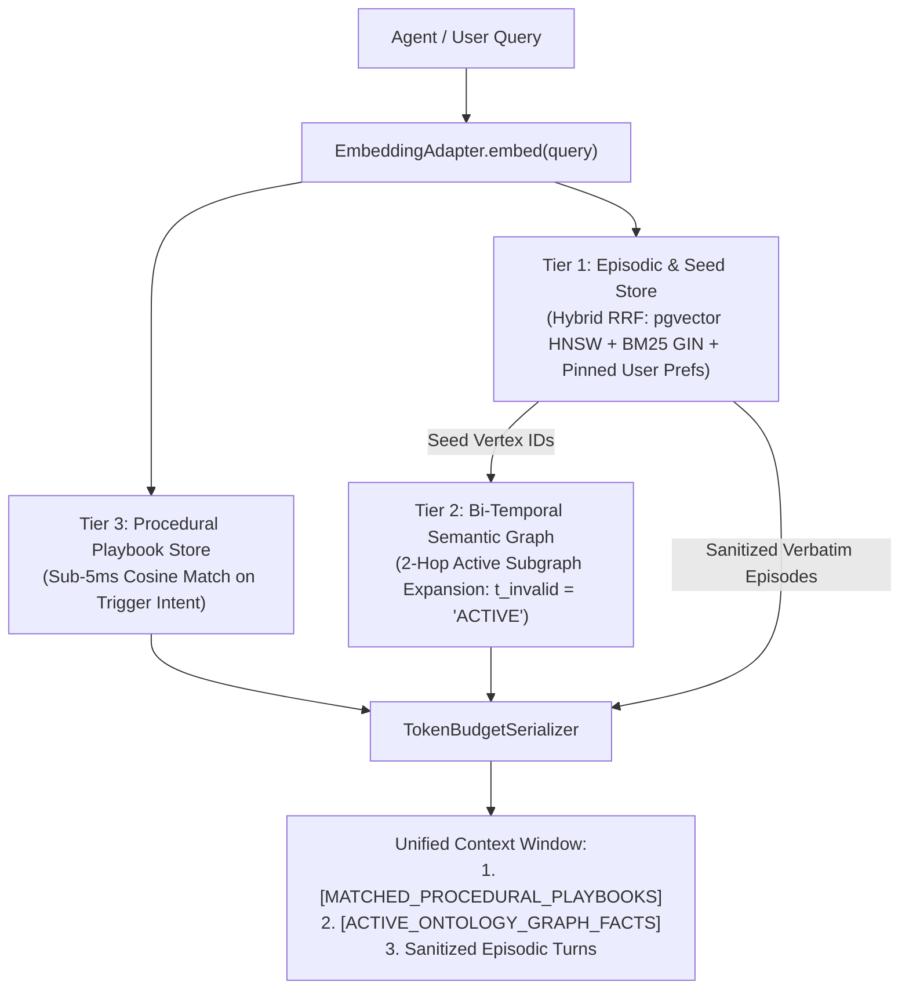

# Enterprise Agentic Memory Platform: Architecture & Ontology Guide

This document details the architectural foundations of **`agentic-composite-memory`** (`import agentic_composite_memory` / `import agentic_memory_sdk`), engineered for **Google Agent Development Kit (ADK)** platforms hosting 100s of agents across diverse business domains.

---

## 1. First Principles: Domain Model vs. Ontology (TBox) vs. Graph KB (ABox)

| Layer | Formal Role | What It Defines | Mutability | Representation in SDK | Failure Mode if Omitted |
| :--- | :--- | :--- | :--- | :--- | :--- |
| **1. Domain Model** | Conceptual Boundary | Bounded context, business vocabulary, core entities, and invariants (e.g., SRE, CRM, Clinical Trials, Payments). | Low | `DomainPackSpec` JSON/YAML/Python/Turtle packs in `examples/domain_packs/`. | Context bleeding across business units. |
| **2. Ontology (TBox)** | Terminological Box (Schema & Rulebook) | Formal classes, `subClassOf` hierarchies, allowed predicates, domain/range rules, disjointness, and functional cardinality (`is_functional`). | Versioned & Governed | `CompiledTBox`, `RelationRule`, OWL `.ttl` & SHACL shapes. | Label & predicate explosion (`uses`, `utilizes`, `relies_on`). |
| **3. Graph KB (ABox)** | Assertional Box (Instance State & Facts) | Populated graph of concrete entity vertices, episodic records, and bi-temporal edges (`t_valid`, `t_invalid`, `t_created`). | High (real-time streaming) | Neo4j (`Bolt`), Amazon Neptune (`openCypher`), PostgreSQL (`pgvector`), Redis, OpenSearch. | Stateless amnesia or contradictory stale facts. |

---

## 2. Stratified Ontology Architecture (Supporting Any Domain Without Bottlenecks)

To support **100s of arbitrary ADK agent apps** on one shared platform without forcing every team to write formal OWL/SHACL upfront, the SDK uses a **3-Layer Stratified Ontology**:

```text
+-----------------------------------------------------------------------------------+
| LAYER 0: PLATFORM UPPER ONTOLOGY & COGNITIVE MEMORY TAXONOMY (Zero-Config)        |
|   Core World Classes:  p:Actor, p:Object, p:Event, p:Concept, p:SpatialLocation,  |
|                        p:QuantitativeMetric                                       |
|   Cognitive Classes:   p:UserPreference, p:PolicyGuardrail, p:WorkingHypothesis,  |
|                        p:EpisodicLesson, p:ProspectiveGoal, p:CandidateConcept    |
|   Properties:          t_valid, t_invalid, t_created, tenant_id, namespace        |
+-----------------------------------------+-----------------------------------------+
                                          | rdfs:subClassOf / Extends
          +-------------------------------+-------------------------------+
          v                                                               v
+-----------------------------------------+     +-----------------------------------+
| LAYER 1: FEDERATED DOMAIN PACKS         |     | LAYER 2: APP-LOCAL EXTENSIONS     |
| (Plug-and-Play Shared Business TBoxes)  |     | (Self-Service / Emergent Schema)  |
|   - retail_omnichannel@1.0.0            |     |   - Inline Python Pydantic models |
|   - sre_infra@v1.2                      |     |   - Auto-quarantined overflow in  |
|   - customer_crm@v2.0                   |     |     `app:{tenant}:{app}`          |
|   - payments@v2.1 (.ttl OWL/SHACL)      |     |   - Bottom-up promotion to TBox   |
+-----------------------------------------+     +-----------------------------------+
```

### The 12 Layer-0 Upper Ontology Classes & Their Automatic Runtime Contracts

Every agent application automatically inherits these 12 domain-agnostic Layer-0 classes (`UpperConceptType`) and 22 universal relations (`_default_layer0_relations()`):

| Layer-0 Class (`UpperConceptType`) | Universal Predicates | Cognitive Role & Automatic Runtime Contract |
| :--- | :--- | :--- |
| **`p:Actor`** | `ASSIGNED_TO`, `OWNED_BY` | People, customers, merchants, teams, organizations, agents. |
| **`p:Object`** | `LOCATED_IN`, `DEPENDS_ON`, `PART_OF` | Physical or digital systems/assets (microservices, DBs, SKUs, warehouses). |
| **`p:Event`** | `CAUSED_BY`, `HAS_STATUS` | Time-bounded occurrences (orders, shipments, incidents, transactions). |
| **`p:Concept`** | `HAS_STATUS`, `RELATED_TO` | Abstract domain concepts, tiers, categories, and lifecycle states. |
| **`p:UserPreference`** | `PREFERS`, `HAS_PREFERENCE` | **Cross-App Persona Contract**: Automatically routed to `user:{tenant}:{user_id}`, immune to session compaction, and included in recall across all apps for that user. |
| **`p:PolicyGuardrail`** | `MUST_NOT_EXECUTE`, `REQUIRES_APPROVAL_FOR`, `CONSTRAINED_BY_POLICY` | **Normative Guardrail Contract**: Auto-detected from negative/compliance constraints (`"must never"`, `"requires approval"`). Pinned against session compaction (`pinned_cognitive=True`) and given `+0.35` salience priority in `TokenBudgetSerializer`. |
| **`p:WorkingHypothesis`** | `HYPOTHESIZES_CAUSE`, `ASSUMES_STATE` | **Epistemic Collapse Protection**: Tags tentative beliefs with `[UNCONFIRMED_HYPOTHESIS]` and forces `is_functional=False` during validation so an unconfirmed theory **never** invalidates a confirmed functional edge. |
| **`p:EpisodicLesson`** | `LEARNED_FROM_FAILURE`, `AVOIDS_PITFALL`, `CORRECTED_BY_USER` | **Reflexion / Self-Improvement Contract**: Captures user corrections and operational postmortems. Immune to session compaction and given `+0.35` salience boost. |
| **`p:ProspectiveGoal`** | `HAS_PENDING_GOAL`, `HAS_GOAL_STATUS`, `BLOCKED_BY` | **Prospective Memory Contract**: Tracks pending follow-ups, SLAs, and deferred intentions. Pinned while active (`+0.20` salience boost) and retired bi-temporally when functional `HAS_GOAL_STATUS` transitions to `COMPLETED`. |
| **`p:QuantitativeMetric`** | `MEASURED_AT_VALUE`, `HAS_THRESHOLD` | **Functional Metric Superseding**: Tracks measurable KPIs, SLAs, and financial figures where new readings bi-temporally supersede old readings (`is_functional=True`). |
| **`p:SpatialLocation`** | `LOCATED_IN` | Physical or logical venues, addresses, and coordinates. |
| **`p:CandidateConcept`** | `RELATED_TO` | **Bucket-2 Quarantine Contract**: Holds emergent out-of-schema concepts (`[ProposedClass=...]`) in `app:{tenant}:{app}` until promoted via `evolve_app_ontology_from_overflow()`. |

### Progressive Governance Tiers (`GovernanceTier`)

1. **Tier 0 (`tier0_auto`)**: Zero configuration required. Writes land in `app:{tenant}:{app}` using Layer 0 (`UpperConceptType`) classes.
2. **Tier 1 (`tier1_app_typed`)**: Developer passes Python Pydantic models or custom classes in `AppMemoryManifest`. Isolated to `app:{tenant}:{app}`.
3. **Tier 2 (`tier2_domain_shared`)**: App subscribes to one or more `DomainPackSpec` packs (`subscribed_domain_packs=["sre_infra@1.0.0"]`). Governed facts are shared in `domain:{tenant}:{domain}`, while non-conforming or low-confidence extractions are routed via the **Two-Bucket Pattern** into `app:{tenant}:{app}` as `p:CandidateConcept`.
4. **Tier 3 (`tier3_enterprise_core`)**: Read-only master reference data in `global:{tenant}:core`.

---

## 3. The 3-Tier Context Graph Topology

When an agent calls `search_memory()`, the platform fuses **3 distinct memory tiers** into a single token-budgeted context window:



1. **Tier 1 — Episodic & Seed Subgraph (`EpisodicRecord` & `GraphVertexUpsert`)**:
   - Immutable raw conversation turns and tool outputs with dense embeddings, pre-scrubbed by `PIIScrubber`.
   - Hybrid Reciprocal Rank Fusion (RRF) search combines dense vector similarity (`pgvector` HNSW) with full-text keyword matching (`tsvector` GIN) and automatically includes pinned `user:{tenant}:{user_id}` preferences across apps.
2. **Tier 2 — Bi-Temporal Semantic Subgraph (`GraphVertexUpsert` & `GraphEdgeMutation`)**:
   - Every relationship edge carries `t_valid`, `t_invalid` (`"ACTIVE"` or ISO timestamp when superseded), `t_created`, `source_episode_id`, and `confidence`.
   - **Functional Predicates (`is_functional=True`)**: When a predicate such as `DEPLOYED_IN_PRIMARY`, `OWNED_BY_PRIMARY`, or `SUBSCRIBED_TO_TIER` receives a new target, the graph adapter automatically closes `t_invalid = new_t_valid` on the superseded edge while preserving historical point-in-time queries (`as_of_iso`).
   - **Entity Resolution Guard (`EntityResolutionGuard`)**: Prevents false vector-similarity merging of distinct numbered or regional identifiers (e.g., `payment-router-01` vs `payment-router-02`, `us-east-1` vs `us-east-2`) even at `0.99` cosine similarity, while merging true surface variants (`Checkout API` vs `checkout-api`).
3. **Tier 3 — Procedural Reasoning Traces & Playbooks (`ReasoningTraceStep` & `PlaybookRecord`)**:
   - Captures `(:AgentRun)-[:EXECUTED_STEP]->(:ToolCall)-[:TOUCHED_ENTITY]->(:Entity)` in the graph and caches proven multi-step workflows (`trigger_intent -> workflow_steps -> resolution_summary`) in `PlaybookStoreAdapter` (Redis or PostgreSQL) for sub-5ms recall.

---

## 4. Hot-Path vs. Sleep-Time Batch Extraction (`ExtractionMode`)

Enterprise agents have different latency/cost profiles:
- **`ExtractionMode.HOT_PATH` (Default)**:
  - Extracts entities and bi-temporal facts immediately during `add_events_to_memory()` (or asynchronously via `non_blocking_memory_commit_callback` after the agent responds).
- **`ExtractionMode.SLEEP_TIME` (`defer_extraction=True`)**:
  - Hot turns only scrub PII, compute the turn embedding, and write the raw `EpisodicRecord` (`extraction_pending=True`) to PostgreSQL/Redis in **<10ms with zero LLM extraction cost**.
  - During idle windows or scheduled Kubernetes `CronJob` runs, `await service.run_memory_maintenance()` batch-extracts pending episodes into the ontology graph, compacts verbose multi-turn sessions into `[AUTO_SESSION_SUMMARY]`, prunes low-confidence overflow edges, and synthesizes **Layer-3 Entity Dossiers** (`[Dossier: pred->target, ...]`).

---

## 5. Bottom-Up Automated Schema Evolution (`evolve_app_ontology_from_overflow`)

When an agent encounters novel domain concepts (e.g., a SecOps agent discovering a new `ZeroDayVulnerability` class and `MITIGATED_BY_WAF_RULE` predicate not yet in the central `sre_infra` Domain Pack):
1. `TBoxRuntimeValidator` quarantines the novel concept in `app:{tenant}:{app}` as `p:CandidateConcept` with `[ProposedClass=...]` and `[ProposedPredicate=...]`, preventing pollution of the shared domain namespace.
2. Calling `await service.evolve_app_ontology_from_overflow(app_name, min_confidence_to_promote=0.85)` evaluates quarantined candidates, anchors new classes to Layer 0 (`UpperConceptType`), infers functional/transitive flags via `PlatformOntologyRegistrar`, bumps the `CompiledTBox` version, promotes the vertices and edges into `domain:{tenant}:{domain}` with all original `source_episode_id` and `t_valid` provenance intact, and records an immutable `OntologyAuditLogEntry`.

---

## 6. Production Edge-Case Defense Matrix

| Edge Scenario | SDK Defense Mechanism | Implementation |
| :--- | :--- | :--- |
| **1. Dual-Write Partial Failure** | Transactional Outbox Pattern (`OutboxOperation` + `process_outbox_batch` / `start_outbox_worker`) | `service.py`, `postgres_pgvector.py` |
| **2. Sibling Identifier False Merge** | `EntityResolutionGuard.can_merge` blocks merging distinct numbers/regions (`aurora-01` vs `aurora-02`) | `governance.py` |
| **3. LLM Schema / SHACL Violation** | Two-Bucket Runtime Validator (`TBoxRuntimeValidator.validate_and_partition`) | `governance.py` |
| **4. Ephemeral Chitchat & Unconfirmed Proposals** | `SmartMemoryClassifier` filters greetings and unconfirmed agent questions (`"Should we fail over?"`) until confirmed | `governance.py`, `service.py` |
| **5. Graph DB Outage / Spike** | `AsyncCircuitBreaker` + automatic fallback to Seed Index summaries (`[DEGRADED_GRAPH_FALLBACK_SUMMARIES]`) | `governance.py`, `service.py` |
| **6. Context Window Overflow** | `TokenBudgetSerializer` ranks active facts by confidence within `max_context_tokens` | `governance.py` |
| **7. PII & Bearer Token Leakage** | Pre-ingestion `PIIScrubber` redacts SSNs, credit cards, API keys, and `Bearer <JWT>` tokens | `governance.py` |
| **8. Right-to-be-Forgotten (GDPR)** | Cascading lineage purge (`purge_user_lineage`) across Episodic, Seed, and Graph stores | `service.py`, `adapters/` |
